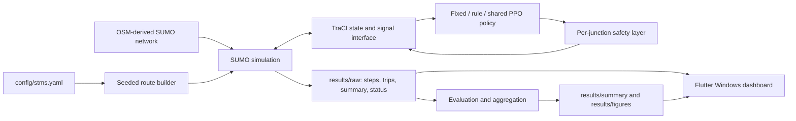

# Smart Traffic Management System

This project evaluates fixed-time, rule-based, and PPO traffic-signal control in SUMO. It uses SUMO/TraCI traffic states and a safety layer. The final evaluation is network-wide over the frozen intended TLS set; the Flutter desktop dashboard reads saved CSV/JSON files and does not control SUMO.

## Architecture



## Verified environment

- Windows 11; Python 3.14.10 in `Ai/.venv` (rechecked 2026-11-05); Eclipse SUMO 1.27.1; CPU-only PyTorch.
- The project metadata permits Python 3.10+, but the complete dependency stack has been verified locally on Python 3.14.x only.
- Ubuntu command-line use is intended, but it has not been validated in this workspace.

Install Python 3.14.x and SUMO 1.27.1, ensure `sumo`, `sumo-gui`, `duarouter`, and `netconvert` are on `PATH`, then run the one-step setup from the repository root:

```powershell
.\setup.bat
```

This creates `Ai/.venv` when needed, installs the pinned Python packages and editable project, runs `flutter pub get` when Flutter is installed, and checks the environment. It reuses an existing `Ai/.venv` and does not replace it. After pulling updates, run `setup.bat` again to reconcile dependencies. Flutter is optional for simulation and Python CLI use; install the Flutter SDK if you also want the desktop dashboard.

Git does not run repository scripts automatically during clone or pull. Run `setup.bat` once after cloning, and again after pulling dependency changes; this keeps installation visible and under the user's control.

For a read-only environment check, use `setup.bat -CheckOnly`. To skip Flutter dependency resolution, use `setup.bat -SkipFlutter`. For Ubuntu, install Python and SUMO from their upstream packages, create/activate `Ai/.venv`, install `requirements.txt` and `requirements-dev.txt`, and verify `SUMO_HOME` plus the four SUMO commands. This setup path has not been run on Ubuntu.

The unverified Ubuntu Python setup commands are:

```bash
python3.14 -m venv Ai/.venv
source Ai/.venv/bin/activate
python -m pip install -r requirements.txt -r requirements-dev.txt
python scripts/check_environment.py
```

## Configuration

`config/stms.yaml` holds the SUMO map path, demand/scenario settings, signal safety bounds, controller settings, final/dev seed blocks, and frozen intended TLS list. Final evaluation blocks are frozen evidence; demo runs use seeds 8000 and above. The network model and gate paths are versioned, and the dashboard reads saved model `config.json` metadata without modifying it.

## Run commands

The exact command order is scenario caches → fixed/rule episodes → the recorded training stage → evaluation → demos → dashboard. The full commands are in [`scripts/run_all.md`](scripts/run_all.md). The accepted M1 main-stage training command is preserved in `docs/experiment_log.md` under T2.3/job `20261026-182735_519e7950`; its output path already contains the accepted model and must not be reused for new training. A single demo command is:

```powershell
Ai/.venv/Scripts/python.exe -m scripts.run_demo --family network --controller rl --scenario net_medium --seed 8000
```

Demo seeds must be at least 8000. The delivered network `rl` demo uses the frozen DEC-14 Stage 4 hybrid and prints the measured AI coverage; this build does not demonstrate full PPO ownership of the intended TLS set. Use the final evaluation command only with the frozen model and the unchanged final block:

```powershell
Ai/.venv/Scripts/python.exe -m Ai.evaluation.evaluate --family network --controllers fixed rule hybrid --seed-set final
```

This final grid already exists in the saved artifacts; do not rerun it after changing model, seeds, scenarios, or metrics. Open the read-only Windows dashboard with:

```powershell
cd dashboard_flutter
C:\src\flutter\bin\flutter.bat run -d windows
```

Select the repository root to read `results/`. More detail is in [`docs/dashboard.md`](docs/dashboard.md).

## Results and outputs

- `results/raw/<run_id>/`: per-run `steps.csv`, `trips.csv`, `summary.csv`, `run.json`, and `status.json`.
- `results/summary/`: evaluation comparisons, run/junction aggregates, route lineage, and snapshots.
- `results/figures/`: generated figures; traffic outcomes are simulated, not real-world measurements.
- `Ai/rl/models/`: versioned model archives and training/config metadata.
- `docs/results.md`: M1 milestone and M2 network result, with provenance and limitations.
- `docs/experiment_log.md`: append-only experiment history.

**M1 single-junction milestone:** the frozen final-seed grid passed lineage (105/105 unique cells) and the report-value test. The provisional controlled-junction common-trip headline is a 9.229% reduction versus fixed-time; the configured 10% target was not met. See `docs/results.md` Part 1.

**M2 final network result (provisional until supervisor item P1):** DEC-14 Stage 4 hybrid common-trip Metric N is **277.532 s**, versus **375.478 s** fixed-time, a **25.84% reduction** (paired 95% CI **22.20–29.49%**), with **100% completion** over 11,500 headline trips. The 10% target is met. **AI coverage: 0/12 (none)** under the frozen 0.95 per-TLS PPO ownership threshold. This is a hybrid-stack performance result and does not demonstrate full AI control of all intended lights.

## Limitations and scope

- The simulations use synthetic demand on an OSM-derived SUMO network. Results are not real-world deployment evidence.
- The final policy uses the documented DEC-14 Stage 4 hybrid fallback. Full PPO ownership was not achieved; see `docs/results.md`.

- Dashboard requirement T5.1 remains partial because its pre-instrumentation config snapshot is missing for the strict same-config comparison. A 30-sample Windows Release freshness measurement for T5.4 recorded a maximum producer-to-frame age of 1676.448 ms against the SRS ≤2 s criterion; this is one measured interval, not a universal bound. T5.4's post-evaluation zombie check passed with no running SUMO/SUMO-GUI processes. Raw measurements are in `docs/evidence/t54_live_freshness_20261105.json`.
- No database, backend/API, authentication, computer vision, camera detection, or traffic-prediction model is in scope or implemented.
- The dashboard is local, unauthenticated and read-only. Raw run artifacts are machine-local and are not committed.

## Map data attribution

The network is derived from OpenStreetMap data. **© OpenStreetMap contributors**; the data is available under the Open Database License (ODbL). See the [OpenStreetMap copyright and license page](https://www.openstreetmap.org/copyright).

## README command audit

| Command group | Execution status |
|---|---|
| Windows setup check and environment check shown above | Executed 2026-11-05; both passed (Python 3.14.10, SUMO 1.27.1). |
| M1 final evaluation: `Ai/.venv/Scripts/python.exe -m Ai.evaluation.evaluate --controllers fixed rule rl --seed-set final --jobs 6` | Executed/resumed 2026-11-06; job `20261106-034321_78312686` RC 0; 105/105 lineage cells; report-value tests 2 passed. |
| Ubuntu setup block (`python3.14 -m venv`, activation, package install, environment check) | Not run; no Ubuntu host or VM is available in this workspace. |
| Network `rl` demo: `Ai/.venv/Scripts/python.exe -m scripts.run_demo --family network --controller rl --scenario net_medium --seed 8000` | Executed 2026-11-06; job `20261106-064946_4a8d4b7c` RC 0; Stage 4 hybrid, 650/650 completed, AI coverage none (0/12). |
| Six fixed/rule/RL single/network seed-8000 demos | Executed 2026-11-06; all six CLI jobs exited RC 0. Dashboard live-view verification remains unverified because the desktop helper native pipe is unavailable. |
| Windows dashboard: `cd dashboard_flutter` then `C:\src\flutter\bin\flutter.bat run -d windows` | The Release app was previously built and used for dashboard checks. This exact launch command and the T6.1 live-view check remain unverified; `@oai/sky.list_apps()` failed again with a native-pipe error, so no visual pass is claimed. |
| Fresh Windows setup: `powershell -NoProfile -ExecutionPolicy Bypass -File .\scripts\setup_windows.ps1` | Not run; this checkout uses an existing `Ai/.venv` and no fresh installation was performed. |
| Clean-clone installation from public package indexes | Not run; this checkout uses the existing `Ai/.venv`, and no fresh network install was performed. |

The final M2 evaluation command above is represented by the saved, audited job in [`docs/results.md`](docs/results.md) Part 3; it is not part of the pending M1 or demo work.
