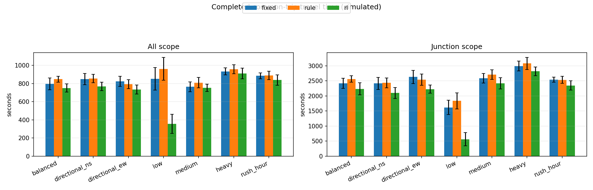
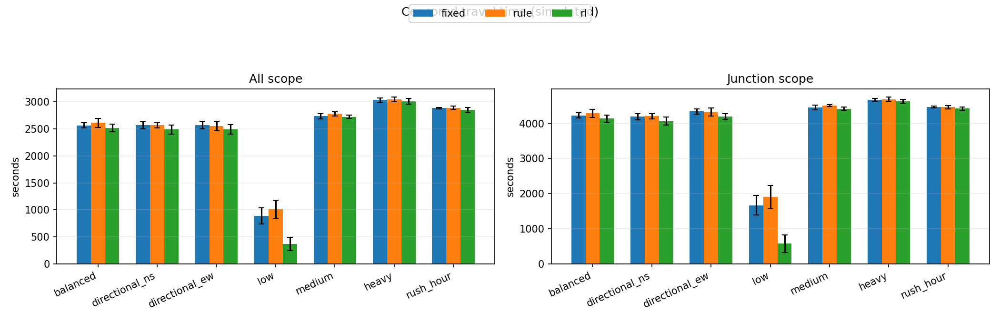
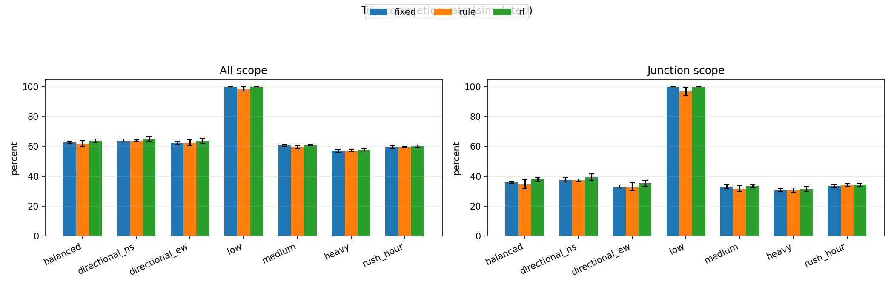
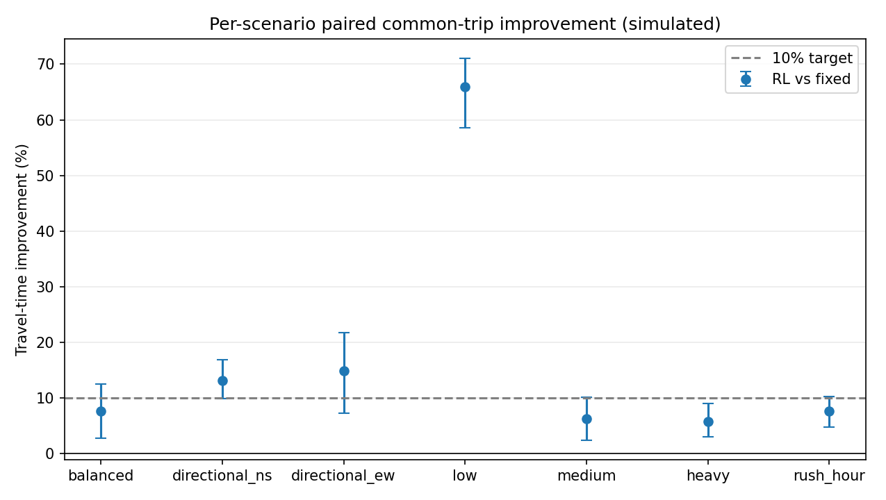
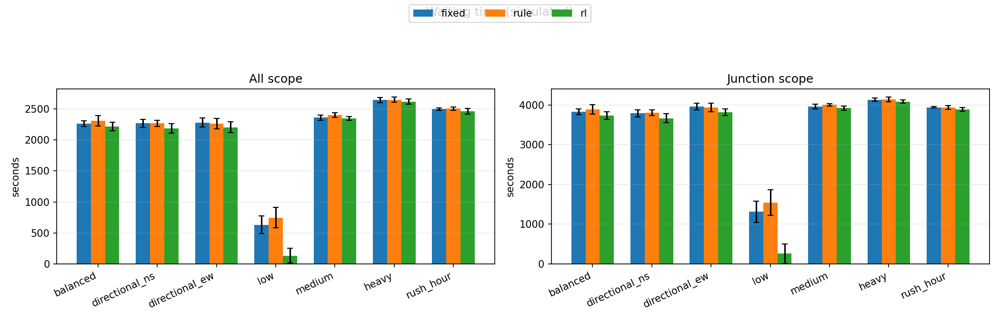
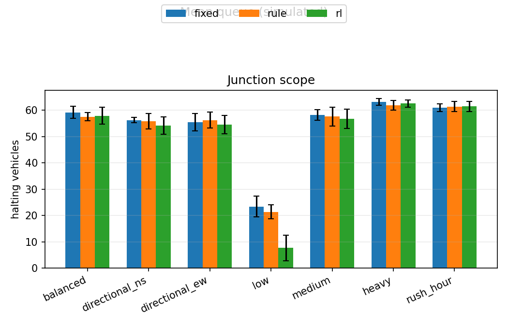
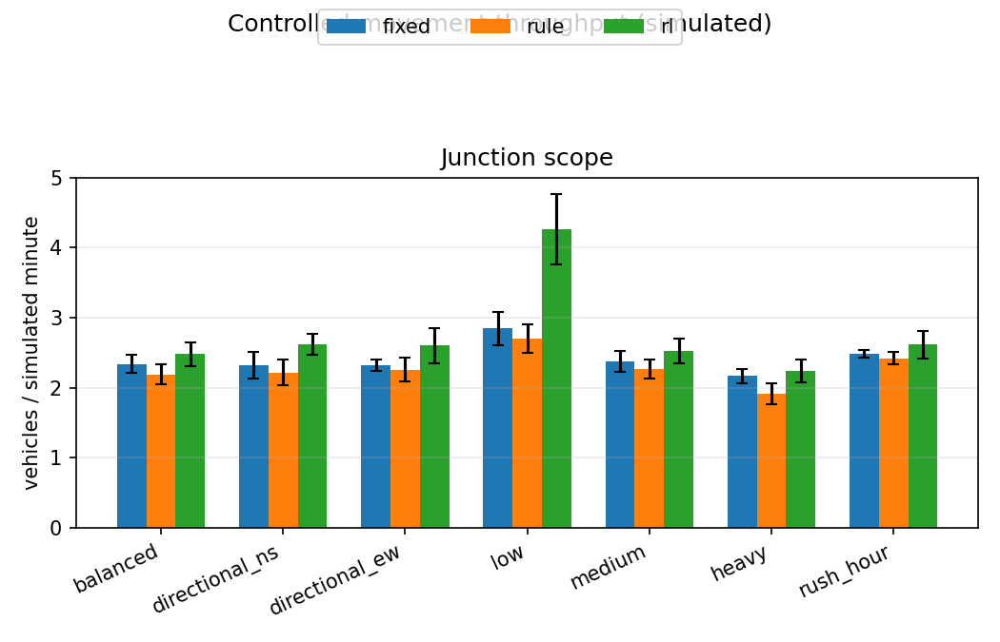

# Evaluation results

## Part 1 — M1 single-junction milestone

**Run and lineage.** The frozen final-seed evaluation used job `20261106-034321_78312686`, command `Ai/.venv/Scripts/python.exe -m Ai.evaluation.evaluate --controllers fixed rule rl --seed-set final --jobs 6`, and finished with return code 0. A fresh full lineage audit accepted **105/105 unique cells** (35 each for fixed, rule and RL), with no missing or duplicate cells; all 35 scenario/seed route groups have matching route lineage across controllers. The frozen `config/stms.yaml` SHA-256 is `322293c6c89cfdeba92c08b7ff65b5858095897adb733abc81200da74c5a7668`. RL used the pinned validation-best checkpoint `Ai/rl/models/ppo_v2_variant_waithalf/evaluations/20261026-182752/best_model.zip` (SHA-256 `9d0e3e82d8aab4e1d38c1e79ad29ec9e637ecd7001500a5b5aad3852c01bc467`). No final-seed tuning or input changes were made.

**Headline Metric B (provisional).** On the controlled-junction common-trip basis, RL travel time is compared with fixed-time; the 10% target is evaluated from the frozen CSV `target_met` field. The report table includes the mean, standard deviation, confidence interval, completion rate, trip count and target fields for every published M1 travel-time row, including Metric A (all trips), Metric B (controlled-junction trips), common-trip and all-scheduled/censored bases, each scenario, `low` separately, and headline/primary/pooled aggregations. Values are copied from `results/summary/comparison.csv` and rounded to three decimals as encoded by the report test.

### CSV-backed travel-time values

| aggregation | scenario | metric | scope | trip_basis | controller | mean | std | ci95_low | ci95_high | n_seeds | n_trips_basis | completion_rate_mean | improvement_vs_fixed_pct | improvement_vs_rule_pct | target_met |
| --- | --- | --- | --- | --- | --- | --- | --- | --- | --- | --- | --- | --- | --- | --- | --- |
| scenario | balanced | travel_time | all | common | fixed | 795.309 | 63.762 | 745.005 | 845.613 | 5 | 4914 | 0.627 | 0.000 | 6.170 |  |
| scenario | balanced | travel_time | all | common | rule | 847.692 | 32.350 | 828.598 | 876.772 | 5 | 4914 | 0.620 | -7.031 | 0.000 |  |
| scenario | balanced | travel_time | all | common | rl | 749.494 | 44.901 | 713.696 | 785.292 | 5 | 4914 | 0.639 | 5.573 | 11.543 | false |
| scenario | balanced | travel_time | all | all | fixed | 2560.917 | 48.036 | 2524.165 | 2597.669 | 5 | 9000 | 0.627 | 0.000 | 1.772 |  |
| scenario | balanced | travel_time | all | all | rule | 2608.437 | 81.022 | 2538.363 | 2657.141 | 5 | 9000 | 0.620 | -1.856 | 0.000 |  |
| scenario | balanced | travel_time | all | all | rl | 2516.221 | 66.870 | 2460.312 | 2561.689 | 5 | 9000 | 0.639 | 1.754 | 3.512 | false |
| scenario | balanced | travel_time | junction | common | fixed | 2419.874 | 168.675 | 2291.787 | 2556.348 | 5 | 1083 | 0.358 | 0.000 | 5.483 |  |
| scenario | balanced | travel_time | junction | common | rule | 2559.781 | 107.077 | 2476.140 | 2639.225 | 5 | 1083 | 0.348 | -6.020 | 0.000 |  |
| scenario | balanced | travel_time | junction | common | rl | 2233.087 | 201.096 | 2081.913 | 2384.261 | 5 | 1083 | 0.381 | 7.678 | 12.866 | false |
| scenario | balanced | travel_time | junction | all | fixed | 4226.809 | 75.966 | 4173.509 | 4294.228 | 5 | 4788 | 0.358 | 0.000 | 1.350 |  |
| scenario | balanced | travel_time | junction | all | rule | 4286.123 | 120.415 | 4194.142 | 4381.174 | 5 | 4788 | 0.348 | -1.400 | 0.000 |  |
| scenario | balanced | travel_time | junction | all | rl | 4137.259 | 100.044 | 4060.978 | 4213.734 | 5 | 4788 | 0.381 | 2.124 | 3.460 | false |
| scenario | directional_ew | travel_time | all | common | fixed | 823.008 | 56.527 | 778.591 | 867.426 | 5 | 5008 | 0.625 | 0.000 | -4.082 |  |
| scenario | directional_ew | travel_time | all | common | rule | 792.925 | 48.843 | 759.083 | 831.301 | 5 | 5008 | 0.625 | 3.302 | 0.000 |  |
| scenario | directional_ew | travel_time | all | common | rl | 733.470 | 49.599 | 696.733 | 771.819 | 5 | 5008 | 0.637 | 10.614 | 7.458 | true |
| scenario | directional_ew | travel_time | all | all | fixed | 2569.273 | 71.206 | 2506.365 | 2614.216 | 5 | 9000 | 0.625 | 0.000 | -0.741 |  |
| scenario | directional_ew | travel_time | all | all | rule | 2552.025 | 91.393 | 2480.753 | 2623.297 | 5 | 9000 | 0.625 | 0.647 | 0.000 |  |
| scenario | directional_ew | travel_time | all | all | rl | 2490.394 | 87.760 | 2414.153 | 2551.711 | 5 | 9000 | 0.637 | 3.064 | 2.392 | false |
| scenario | directional_ew | travel_time | junction | common | fixed | 2629.432 | 216.461 | 2496.639 | 2818.061 | 5 | 1035 | 0.332 | 0.000 | -3.897 |  |
| scenario | directional_ew | travel_time | junction | common | rule | 2538.451 | 187.605 | 2400.411 | 2697.783 | 5 | 1035 | 0.331 | 3.065 | 0.000 |  |
| scenario | directional_ew | travel_time | junction | common | rl | 2225.779 | 136.696 | 2133.177 | 2344.169 | 5 | 1035 | 0.354 | 14.869 | 12.187 | true |
| scenario | directional_ew | travel_time | junction | all | fixed | 4339.869 | 76.692 | 4282.315 | 4403.329 | 5 | 4638 | 0.332 | 0.000 | -0.384 |  |
| scenario | directional_ew | travel_time | junction | all | rule | 4324.992 | 109.715 | 4228.588 | 4402.686 | 5 | 4638 | 0.331 | 0.330 | 0.000 |  |
| scenario | directional_ew | travel_time | junction | all | rl | 4196.418 | 84.556 | 4133.106 | 4257.882 | 5 | 4638 | 0.354 | 3.286 | 2.948 | false |
| scenario | directional_ns | travel_time | all | common | fixed | 848.819 | 62.574 | 797.104 | 895.854 | 5 | 4989 | 0.639 | 0.000 | 0.386 |  |
| scenario | directional_ns | travel_time | all | common | rule | 854.489 | 47.243 | 820.640 | 894.407 | 5 | 4989 | 0.639 | -1.151 | 0.000 |  |
| scenario | directional_ns | travel_time | all | common | rl | 766.920 | 46.867 | 725.742 | 799.482 | 5 | 4989 | 0.650 | 9.482 | 10.175 | false |
| scenario | directional_ns | travel_time | all | all | fixed | 2567.084 | 66.332 | 2515.110 | 2614.806 | 5 | 9000 | 0.639 | 0.000 | 0.068 |  |
| scenario | directional_ns | travel_time | all | all | rule | 2569.315 | 53.206 | 2536.115 | 2615.529 | 5 | 9000 | 0.639 | -0.126 | 0.000 |  |
| scenario | directional_ns | travel_time | all | all | rl | 2487.631 | 81.600 | 2432.014 | 2560.858 | 5 | 9000 | 0.650 | 3.091 | 3.193 | false |
| scenario | directional_ns | travel_time | junction | common | fixed | 2414.486 | 202.016 | 2253.104 | 2560.092 | 5 | 1137 | 0.378 | 0.000 | 0.514 |  |
| scenario | directional_ns | travel_time | junction | common | rule | 2434.353 | 163.447 | 2324.297 | 2567.990 | 5 | 1137 | 0.374 | -1.357 | 0.000 |  |
| scenario | directional_ns | travel_time | junction | common | rl | 2096.187 | 182.228 | 1956.311 | 2251.534 | 5 | 1137 | 0.394 | 13.101 | 13.841 | true |
| scenario | directional_ns | travel_time | junction | all | fixed | 4196.179 | 88.474 | 4130.022 | 4264.481 | 5 | 4800 | 0.378 | 0.000 | 0.173 |  |
| scenario | directional_ns | travel_time | junction | all | rule | 4204.060 | 74.304 | 4151.545 | 4270.462 | 5 | 4800 | 0.374 | -0.213 | 0.000 |  |
| scenario | directional_ns | travel_time | junction | all | rl | 4065.748 | 117.545 | 4000.100 | 4169.459 | 5 | 4800 | 0.394 | 3.111 | 3.297 | false |
| scenario | heavy | travel_time | all | common | fixed | 931.843 | 38.925 | 902.337 | 961.461 | 5 | 8364 | 0.571 | 0.000 | 2.465 |  |
| scenario | heavy | travel_time | all | common | rule | 956.267 | 50.313 | 911.399 | 987.376 | 5 | 8364 | 0.572 | -2.623 | 0.000 |  |
| scenario | heavy | travel_time | all | common | rl | 909.892 | 59.001 | 857.550 | 948.439 | 5 | 8364 | 0.578 | 2.367 | 4.654 | false |
| scenario | heavy | travel_time | all | all | fixed | 3031.495 | 42.599 | 2999.367 | 3063.623 | 5 | 18000 | 0.571 | 0.000 | 0.386 |  |
| scenario | heavy | travel_time | all | all | rule | 3043.406 | 43.927 | 3006.826 | 3076.405 | 5 | 18000 | 0.572 | -0.397 | 0.000 |  |
| scenario | heavy | travel_time | all | all | rl | 3006.243 | 51.339 | 2962.885 | 3043.114 | 5 | 18000 | 0.578 | 0.834 | 1.212 | false |
| scenario | heavy | travel_time | junction | common | fixed | 2989.618 | 162.933 | 2840.295 | 3101.874 | 5 | 1337 | 0.308 | 0.000 | 2.809 |  |
| scenario | heavy | travel_time | junction | common | rule | 3078.103 | 198.165 | 2914.385 | 3219.390 | 5 | 1337 | 0.307 | -2.932 | 0.000 |  |
| scenario | heavy | travel_time | junction | common | rl | 2814.934 | 147.137 | 2699.773 | 2923.504 | 5 | 1337 | 0.315 | 5.760 | 8.377 | false |
| scenario | heavy | travel_time | junction | all | fixed | 4670.813 | 38.806 | 4636.106 | 4696.760 | 5 | 9510 | 0.308 | 0.000 | 0.363 |  |
| scenario | heavy | travel_time | junction | all | rule | 4688.194 | 63.306 | 4639.874 | 4736.515 | 5 | 9510 | 0.307 | -0.371 | 0.000 |  |
| scenario | heavy | travel_time | junction | all | rl | 4625.861 | 54.161 | 4596.439 | 4674.236 | 5 | 9510 | 0.315 | 0.961 | 1.323 | false |
| scenario | low | travel_time | all | common | fixed | 850.670 | 122.657 | 758.301 | 950.743 | 5 | 3449 | 1.000 | 0.000 | 11.363 |  |
| scenario | low | travel_time | all | common | rule | 960.757 | 125.296 | 862.829 | 1057.213 | 5 | 3449 | 0.985 | -13.352 | 0.000 |  |
| scenario | low | travel_time | all | common | rl | 356.526 | 104.796 | 298.727 | 450.255 | 5 | 3449 | 1.000 | 58.531 | 63.131 | true |
| scenario | low | travel_time | all | all | fixed | 888.134 | 149.793 | 765.954 | 1007.815 | 5 | 3500 | 1.000 | 0.000 | 11.711 |  |
| scenario | low | travel_time | all | all | rule | 1008.524 | 167.646 | 865.467 | 1136.673 | 5 | 3500 | 0.985 | -13.846 | 0.000 |  |
| scenario | low | travel_time | all | all | rl | 367.990 | 121.768 | 300.484 | 477.983 | 5 | 3500 | 1.000 | 59.072 | 63.694 | true |
| scenario | low | travel_time | junction | common | fixed | 1617.879 | 238.592 | 1426.611 | 1809.244 | 5 | 1567 | 1.000 | 0.000 | 11.652 |  |
| scenario | low | travel_time | junction | common | rule | 1835.285 | 264.118 | 1629.599 | 2040.971 | 5 | 1567 | 0.969 | -13.752 | 0.000 |  |
| scenario | low | travel_time | junction | common | rl | 561.258 | 219.765 | 434.303 | 759.430 | 5 | 1567 | 1.000 | 65.964 | 69.787 | true |
| scenario | low | travel_time | junction | all | fixed | 1672.040 | 281.425 | 1468.862 | 1883.089 | 5 | 1618 | 1.000 | 0.000 | 12.022 |  |
| scenario | low | travel_time | junction | all | rule | 1907.314 | 330.054 | 1651.534 | 2163.094 | 5 | 1618 | 0.969 | -14.286 | 0.000 |  |
| scenario | low | travel_time | junction | all | rl | 577.906 | 248.576 | 436.559 | 801.260 | 5 | 1618 | 1.000 | 66.192 | 70.062 | true |
| scenario | medium | travel_time | all | common | fixed | 763.717 | 54.174 | 724.584 | 809.939 | 5 | 6597 | 0.606 | 0.000 | 5.494 |  |
| scenario | medium | travel_time | all | common | rule | 808.819 | 58.305 | 766.816 | 858.217 | 5 | 6597 | 0.595 | -5.979 | 0.000 |  |
| scenario | medium | travel_time | all | common | rl | 751.155 | 39.628 | 725.392 | 786.449 | 5 | 6597 | 0.608 | 1.375 | 6.905 | false |
| scenario | medium | travel_time | all | all | fixed | 2732.485 | 46.579 | 2694.138 | 2762.838 | 5 | 13000 | 0.606 | 0.000 | 1.615 |  |
| scenario | medium | travel_time | all | all | rule | 2777.353 | 39.662 | 2744.197 | 2804.251 | 5 | 13000 | 0.595 | -1.650 | 0.000 |  |
| scenario | medium | travel_time | all | all | rl | 2722.343 | 33.701 | 2695.415 | 2746.891 | 5 | 13000 | 0.608 | 0.361 | 1.972 | false |
| scenario | medium | travel_time | junction | common | fixed | 2585.034 | 156.797 | 2453.741 | 2689.395 | 5 | 1170 | 0.330 | 0.000 | 4.269 |  |
| scenario | medium | travel_time | junction | common | rule | 2707.230 | 155.500 | 2592.181 | 2825.680 | 5 | 1170 | 0.317 | -5.043 | 0.000 |  |
| scenario | medium | travel_time | junction | common | rl | 2420.317 | 186.013 | 2298.272 | 2579.052 | 5 | 1170 | 0.335 | 6.331 | 10.505 | false |
| scenario | medium | travel_time | junction | all | fixed | 4452.850 | 62.974 | 4409.666 | 4503.340 | 5 | 6736 | 0.330 | 0.000 | 1.274 |  |
| scenario | medium | travel_time | junction | all | rule | 4510.355 | 29.617 | 4486.535 | 4532.948 | 5 | 6736 | 0.317 | -1.305 | 0.000 |  |
| scenario | medium | travel_time | junction | all | rl | 4419.106 | 45.126 | 4383.596 | 4454.616 | 5 | 6736 | 0.335 | 0.752 | 2.022 | false |
| scenario | rush_hour | travel_time | all | common | fixed | 884.003 | 31.977 | 862.134 | 912.564 | 5 | 7776 | 0.596 | 0.000 | 0.307 |  |
| scenario | rush_hour | travel_time | all | common | rule | 887.709 | 46.002 | 851.563 | 922.550 | 5 | 7776 | 0.597 | -0.417 | 0.000 |  |
| scenario | rush_hour | travel_time | all | common | rl | 837.639 | 57.224 | 792.632 | 882.645 | 5 | 7776 | 0.601 | 5.277 | 5.541 | false |
| scenario | rush_hour | travel_time | all | all | fixed | 2884.358 | 14.106 | 2875.652 | 2896.880 | 5 | 16000 | 0.596 | 0.000 | 0.183 |  |
| scenario | rush_hour | travel_time | all | all | rule | 2889.797 | 27.110 | 2865.465 | 2906.300 | 5 | 16000 | 0.597 | -0.189 | 0.000 |  |
| scenario | rush_hour | travel_time | all | all | rl | 2853.149 | 42.733 | 2819.416 | 2886.883 | 5 | 16000 | 0.601 | 1.085 | 1.267 | false |
| scenario | rush_hour | travel_time | junction | common | fixed | 2537.773 | 82.512 | 2465.979 | 2595.991 | 5 | 1426 | 0.336 | 0.000 | -0.442 |  |
| scenario | rush_hour | travel_time | junction | common | rule | 2530.956 | 117.372 | 2444.640 | 2617.248 | 5 | 1426 | 0.341 | 0.181 | 0.000 |  |
| scenario | rush_hour | travel_time | junction | common | rl | 2346.483 | 155.056 | 2225.246 | 2467.720 | 5 | 1426 | 0.344 | 7.607 | 7.171 | false |
| scenario | rush_hour | travel_time | junction | all | fixed | 4469.086 | 23.103 | 4449.595 | 4486.647 | 5 | 8547 | 0.336 | 0.000 | -0.103 |  |
| scenario | rush_hour | travel_time | junction | all | rule | 4464.719 | 46.481 | 4422.911 | 4495.258 | 5 | 8547 | 0.341 | 0.099 | 0.000 |  |
| scenario | rush_hour | travel_time | junction | all | rl | 4420.661 | 48.643 | 4381.277 | 4458.718 | 5 | 8547 | 0.344 | 1.086 | 0.983 | false |
| headline | headline | travel_time | all | common | fixed | 841.117 | 19.678 | 826.289 | 855.945 | 5 | 37648 | 0.611 | 0.000 | 1.968 |  |
| headline | headline | travel_time | all | common | rule | 857.984 | 8.917 | 851.018 | 864.949 | 5 | 37648 | 0.608 | -2.039 | 0.000 |  |
| headline | headline | travel_time | all | common | rl | 791.428 | 13.004 | 781.944 | 802.063 | 5 | 37648 | 0.619 | 5.880 | 7.749 | false |
| headline | headline | travel_time | all | all | fixed | 2724.269 | 23.576 | 2706.471 | 2743.607 | 5 | 74000 | 0.611 | 0.000 | 0.577 |  |
| headline | headline | travel_time | all | all | rule | 2740.056 | 11.093 | 2732.294 | 2749.698 | 5 | 74000 | 0.608 | -0.583 | 0.000 |  |
| headline | headline | travel_time | all | all | rl | 2679.330 | 14.526 | 2669.745 | 2692.604 | 5 | 74000 | 0.619 | 1.647 | 2.216 | false |
| headline | headline | travel_time | junction | common | fixed | 2596.036 | 45.147 | 2562.336 | 2629.736 | 5 | 7188 | 0.340 | 0.000 | 1.710 |  |
| headline | headline | travel_time | junction | common | rule | 2641.479 | 22.847 | 2620.174 | 2655.928 | 5 | 7188 | 0.336 | -1.779 | 0.000 |  |
| headline | headline | travel_time | junction | common | rl | 2356.131 | 53.429 | 2315.166 | 2394.899 | 5 | 7188 | 0.354 | 9.229 | 10.790 | false |
| headline | headline | travel_time | junction | all | fixed | 4392.601 | 29.513 | 4369.296 | 4415.245 | 5 | 39019 | 0.340 | 0.000 | 0.464 |  |
| headline | headline | travel_time | junction | all | rule | 4413.074 | 18.310 | 4398.854 | 4427.294 | 5 | 39019 | 0.336 | -0.468 | 0.000 |  |
| headline | headline | travel_time | junction | all | rl | 4310.842 | 23.463 | 4293.309 | 4329.694 | 5 | 39019 | 0.354 | 1.860 | 2.317 | false |
| primary | primary | travel_time | all | common | fixed | 859.855 | 14.125 | 848.312 | 870.459 | 5 | 22737 | 0.591 | 0.000 | 2.733 |  |
| primary | primary | travel_time | all | common | rule | 884.265 | 13.609 | 873.438 | 894.744 | 5 | 22737 | 0.588 | -2.871 | 0.000 |  |
| primary | primary | travel_time | all | common | rl | 832.895 | 19.157 | 815.578 | 845.762 | 5 | 22737 | 0.596 | 3.141 | 5.784 | false |
| primary | primary | travel_time | all | all | fixed | 2882.779 | 17.791 | 2871.069 | 2897.467 | 5 | 47000 | 0.591 | 0.000 | 0.713 |  |
| primary | primary | travel_time | all | all | rule | 2903.519 | 14.863 | 2891.002 | 2913.345 | 5 | 47000 | 0.588 | -0.721 | 0.000 |  |
| primary | primary | travel_time | all | all | rl | 2860.578 | 12.982 | 2850.391 | 2870.515 | 5 | 47000 | 0.596 | 0.769 | 1.478 | false |
| primary | primary | travel_time | junction | common | fixed | 2704.142 | 88.766 | 2635.099 | 2769.497 | 5 | 3933 | 0.325 | 0.000 | 2.397 |  |
| primary | primary | travel_time | junction | common | rule | 2772.097 | 77.134 | 2713.356 | 2830.837 | 5 | 3933 | 0.321 | -2.597 | 0.000 |  |
| primary | primary | travel_time | junction | common | rl | 2527.245 | 87.211 | 2458.734 | 2595.756 | 5 | 3933 | 0.331 | 6.538 | 8.805 | false |
| primary | primary | travel_time | junction | all | fixed | 4530.916 | 28.552 | 4510.072 | 4555.400 | 5 | 24793 | 0.325 | 0.000 | 0.514 |  |
| primary | primary | travel_time | junction | all | rule | 4554.423 | 27.632 | 4533.154 | 4574.774 | 5 | 24793 | 0.321 | -0.521 | 0.000 |  |
| primary | primary | travel_time | junction | all | rl | 4488.543 | 22.357 | 4471.011 | 4505.297 | 5 | 24793 | 0.331 | 0.934 | 1.446 | false |
| low | low | travel_time | all | common | fixed | 850.670 | 122.657 | 758.301 | 950.743 | 5 | 3449 | 1.000 | 0.000 | 11.363 |  |
| low | low | travel_time | all | common | rule | 960.757 | 125.296 | 862.829 | 1053.982 | 5 | 3449 | 0.985 | -13.352 | 0.000 |  |
| low | low | travel_time | all | common | rl | 356.526 | 104.796 | 298.727 | 451.000 | 5 | 3449 | 1.000 | 58.531 | 63.131 | true |
| low | low | travel_time | all | all | fixed | 888.134 | 149.793 | 771.540 | 1003.062 | 5 | 3500 | 1.000 | 0.000 | 11.711 |  |
| low | low | travel_time | all | all | rule | 1008.524 | 167.646 | 878.721 | 1138.327 | 5 | 3500 | 0.985 | -13.846 | 0.000 |  |
| low | low | travel_time | all | all | rl | 367.990 | 121.768 | 300.484 | 477.983 | 5 | 3500 | 1.000 | 59.072 | 63.694 | true |
| low | low | travel_time | junction | common | fixed | 1617.879 | 238.592 | 1431.783 | 1809.244 | 5 | 1567 | 1.000 | 0.000 | 11.652 |  |
| low | low | travel_time | junction | common | rule | 1835.285 | 264.118 | 1629.599 | 2040.971 | 5 | 1567 | 0.969 | -13.752 | 0.000 |  |
| low | low | travel_time | junction | common | rl | 561.258 | 219.765 | 435.604 | 759.430 | 5 | 1567 | 1.000 | 65.964 | 69.787 | true |
| low | low | travel_time | junction | all | fixed | 1672.040 | 281.425 | 1468.915 | 1887.013 | 5 | 1618 | 1.000 | 0.000 | 12.022 |  |
| low | low | travel_time | junction | all | rule | 1907.314 | 330.054 | 1651.534 | 2163.094 | 5 | 1618 | 0.969 | -14.286 | 0.000 |  |
| low | low | travel_time | junction | all | rl | 577.906 | 248.576 | 436.559 | 801.473 | 5 | 1618 | 1.000 | 66.192 | 70.062 | true |
| pooled | pooled | travel_time | all | common | fixed | 849.388 | 16.095 | 836.911 | 861.865 | 5 | 41097 | 0.622 | 0.000 | 2.887 |  |
| pooled | pooled | travel_time | all | common | rule | 874.686 | 14.410 | 864.367 | 886.999 | 5 | 41097 | 0.619 | -2.992 | 0.000 |  |
| pooled | pooled | travel_time | all | common | rl | 766.153 | 18.522 | 753.309 | 782.491 | 5 | 41097 | 0.629 | 9.795 | 12.388 | false |
| pooled | pooled | travel_time | all | all | fixed | 2691.908 | 16.511 | 2679.205 | 2704.611 | 5 | 77500 | 0.622 | 0.000 | 0.761 |  |
| pooled | pooled | travel_time | all | all | rule | 2712.535 | 8.223 | 2706.516 | 2719.620 | 5 | 77500 | 0.619 | -0.768 | 0.000 |  |
| pooled | pooled | travel_time | all | all | rl | 2630.831 | 13.997 | 2620.084 | 2641.603 | 5 | 77500 | 0.629 | 2.268 | 3.012 | false |
| pooled | pooled | travel_time | junction | common | fixed | 2428.225 | 40.976 | 2396.487 | 2458.391 | 5 | 8755 | 0.362 | 0.000 | 2.987 |  |
| pooled | pooled | travel_time | junction | common | rule | 2503.569 | 61.334 | 2451.822 | 2548.390 | 5 | 8755 | 0.358 | -3.101 | 0.000 |  |
| pooled | pooled | travel_time | junction | common | rl | 2045.432 | 52.204 | 2001.339 | 2083.743 | 5 | 8755 | 0.373 | 15.757 | 18.257 | true |
| pooled | pooled | travel_time | junction | all | fixed | 4326.643 | 17.163 | 4313.956 | 4339.854 | 5 | 40637 | 0.362 | 0.000 | 0.643 |  |
| pooled | pooled | travel_time | junction | all | rule | 4354.641 | 10.172 | 4346.691 | 4362.142 | 5 | 40637 | 0.358 | -0.648 | 0.000 |  |
| pooled | pooled | travel_time | junction | all | rl | 4214.466 | 11.588 | 4207.947 | 4225.097 | 5 | 40637 | 0.373 | 2.592 | 3.219 | false |

**Interpretation and limits.** This is the single-junction M1 milestone, not the final result. The 10% target status for every metric and scope is shown in `target_met`; no target attainment is inferred. The T2.5 RL sanity gate passed on its validation-seed acceptance; see `docs/rl_diagnostics.md`. Metric B is provisional until P1. The comparison is a SUMO simulation with synthetic demand and cars only; it is not real-world validation. Common-trip values are shown beside all-scheduled censored values and completion rates to expose unfinished trips and survivorship effects. The final deliverable remains network-wide control. The accepted M2 result is DEC-14 Stage 4 hybrid with AI coverage **0/12 (none)**, so no full-network AI coverage claim is made.

**Figures (simulated).**

## Part 2 — M2 network development evaluation (T4.8; not final)

**Scope and provenance.** The authorized dev command was `Ai/.venv/Scripts/python.exe -m Ai.evaluation.evaluate --family network --controllers fixed rule rl --seed-set dev`, job `20261101-130401_d0dddfe6`, return code 0. It completed 75/75 scenario × seed × controller cells for `net_balanced`, `net_low`, `net_medium`, `net_heavy`, `net_rush_hour`, seeds 5000–5004, fixed/rule/RL. Full artifact and lineage validation found 75 valid, 0 invalid, 0 incomplete cells. All 25 scenario/seed route groups use the same route SHA across the three controllers. RL used only `Ai/rl/models/ppo_net_v2_rejection_penalty_005/evaluations/best_model.zip`, SHA-256 `758711e7f28e29e69b59af6eade30ba679c3160daadf39e09ed89287f5037757`.

**Metric N.** Primary values are completed common trips, computed by averaging seeds within each scenario and equally averaging the four non-low scenarios for the headline. Travel time is seconds; improvement is `(fixed − RL) / fixed × 100`. The 95% interval shown is the paired-bootstrap interval for the improvement versus fixed, from `comparison.csv`.

| Scenario / aggregation | Fixed (s) | Rule (s) | RL (s) | RL reduction vs fixed (95% CI) | Common trips | Completion, fixed/rule/RL |
|---|---:|---:|---:|---:|---:|---:|
| `net_balanced` | 374.202 | 327.962 | 319.242 | 14.61% (12.94–16.55%) | 1,750 | 100% / 100% / 100% |
| `net_medium` | 327.050 | 277.796 | 265.704 | 18.54% (15.79–22.57%) | 3,250 | 100% / 100% / 100% |
| `net_heavy` | 461.409 | 341.395 | 275.193 | 39.50% (32.98–44.85%) | 4,000 | 100% / 100% / 100% |
| `net_rush_hour` | 293.367 | 260.663 | 255.443 | 12.84% (10.68–14.91%) | 2,500 | 100% / 100% / 100% |
| **Headline** (unweighted mean of the four rows above) | **364.007** | **301.954** | **278.895** | **23.35% (22.08–24.69%)** | **11,500** | **100% / 100% / 100%** |
| `net_low` (separate; excluded from headline) | 323.936 | 294.583 | 287.662 | 11.11% (9.15–12.96%) | 1,250 | 100% / 100% / 100% |

The configured 10% target is **MET on this development headline** (`target_met=true`). The pooled-trip sensitivity, including `net_low`, is 25.04% lower travel time versus fixed (12,750 trips). Since all runs completed every scheduled trip, the completed-common and all-scheduled censored travel-time means coincide; completion is 100%, and there is no completion-gap survivorship difference in these results. The headline RL reduction versus rule is 7.48%.

**Coverage, fallback, and safety.** Each RL cell loaded and used the pinned model, but under the frozen `eval.ai_coverage_min_share=0.95` definition all 25 RL cells report `ai_coverage=none` (`n_tls_ai=0/12`). Across the 60 RL per-scenario/per-junction rows, PPO owned 26.67–79.94% of ticks (mean 41.39%); fallback owned 20.06–73.33% (mean 58.61%). No junction reached 95% PPO tick ownership. The 25 RL cells recorded 147,123 safety rejections and zero forced max-green switches. Mean per-run median batch inference latency was 2.386 ms; the maximum recorded batch latency was 1,095.353 ms and should be reviewed as a latency outlier before drawing operational conclusions. These measurements do not establish complete AI ownership across the network.

**Censored/safety/junction outputs.** `results/summary/network_runs.csv` contains one row per run with coverage, common-trip count, completion, censored and common travel time, fallback share, safety counts, inference latency, route hash, and model identity. `results/summary/network_junctions.csv` contains 180 scenario/controller/TLS rows with queue, wait, congestion, controller ownership/tick shares, fallback and safety diagnostics. `results/figures/network_junction_congestion.png` is a simulated per-junction congestion figure. `results/summary/comparison.csv` contains 1,782 M1 development rows, 1,782 M1 final rows, and 1,457 M2 final rows. The M2 final rows are preserved from the accepted `comparison_t410_hybrid_final_snapshot.csv` (SHA-256 `8aefa3c0a2ae2ac13e9528de5da410670a1a74cc95f47adf0d706468f712dcd4`); current M2 raw metadata carries config SHA-256 `99a432c2912d0320ca0bf61f9435781f2d8cbdb1f282fdeddc391c3da4408e16`, so deterministic reaggregation under the current config is rejected. No saved M2 rows were recalculated or changed.

**Reproducibility and checks.** Rebuilding aggregation twice produced byte-identical `comparison.csv`, SHA-256 `047cf3e163156d9f6db82b36de80ddc43cadd612ea9898d8389bc70ba17cef45`. The 1,782 M1 rows retain canonical SHA-256 `341f3ab8dd8bc9d288845d30635751cdcf0bd6e0361bdbefcac565e751fb02fb`. `pytest -q tests/test_evaluation_network.py tests/test_evaluation.py tests/test_metrics_network.py tests/test_run_episode.py tests/test_scenarios.py`: **25 passed**. Changed-file Ruff: **All checks passed**. Evaluation wall time was 2 h 22 min 53 s; the serial estimate was approximately 6.2 h before launch. A nonfatal Matplotlib tight-layout warning occurred while creating the congestion figure.

**Status and limitations.** T4.8's development harness gate passes. These are synthetic-demand SUMO development seeds, not final-seed results or real-world validation. The 10% development result does not satisfy T4.9 final acceptance. `ai_coverage=none` under the 0.95 ownership rule is an explicit reliability/coverage limitation. The final-seed gate and conditional T4.10 path are recorded below.

## T4.9 final-seed PPO-only audit (pre-T4.10; preserved historical result)

Job `20261101-160643_0cb80208` ran the exact final command `Ai/.venv/Scripts/python.exe -m Ai.evaluation.evaluate --family network --controllers fixed rule rl --seed-set final`, finished with return code 0, and validated 75/75 cells (0 invalid/incomplete) across the five frozen scenarios and seeds 6000–6004. All 25 scenario/seed triplets have one matching route SHA across fixed/rule/RL. RL loaded the frozen T4.7 candidate SHA-256 `758711e7f28e29e69b59af6eade30ba679c3160daadf39e09ed89287f5037757`; no training or final-seed tuning occurred. Actual wall time was 2 h 21 min 30 s. The final grid, original route artifacts and aggregates are retained; the final PPO-only aggregates are snapshotted as `results/summary/*_t49_rl_final_snapshot.csv`.

At the DEC-12 completed-common-trip basis, Metric N headline (unweighted mean across `net_balanced`, `net_medium`, `net_heavy`, `net_rush_hour`) was 277.936 s RL, 375.478 s fixed and 298.471 s rule: **25.74% lower than fixed** (paired-bootstrap 95% CI 22.21–29.28%, `target_met=true`). Completion was 100% (11,500/11,500 common trips); censored travel time was identical to common-trip travel time. Including `net_low`, pooled sensitivity was 26.95% lower than fixed across 12,750 trips. Scenario common-trip results:

| Scenario | Fixed (s) | Rule (s) | PPO (s) | Reduction vs fixed (95% CI) | Common trips | Completion fixed/rule/PPO |
|---|---:|---:|---:|---:|---:|---:|
| `net_balanced` | 406.456 | 333.340 | 321.540 | 19.63% (13.58–28.74%) | 1,750 | 100% / 100% / 100% |
| `net_medium` | 322.390 | 275.869 | 268.933 | 16.56% (15.20–17.81%) | 3,250 | 100% / 100% / 100% |
| `net_heavy` | 470.900 | 315.090 | 264.743 | 42.86% (37.27–48.85%) | 4,000 | 100% / 100% / 100% |
| `net_rush_hour` | 302.165 | 269.584 | 256.527 | 14.71% (11.93–19.90%) | 2,500 | 100% / 100% / 100% |
| `net_low` (separate) | 314.690 | 290.279 | 281.074 | 10.67% (9.54–12.29%) | 1,250 | 100% / 100% / 100% |

**Historical PPO-only coverage:** the final audit found all 25 PPO runs below the configured per-TLS PPO ownership threshold of 0.95, so coverage was `none` at 0/12; weighted fallback ownership averaged 58.64%. Across the 25 PPO cells all 12 TLS had a nonzero but sub-threshold PPO share. Per-TLS PPO share across five scenarios was: `2387385680` 79.18%, `GS_2407671508` 36.21%, `GS_cluster_11178931802_11178931803_2414626606_6887565739` 29.19%, `GS_cluster_12067305554_6017833806_6017833807_6131076159` 72.13%, `cluster11259448953_11259448962_11259448969_cluster_11259448960_11259448961_11259448963` 33.36%, `cluster11260122965_12067305543_12067305544_cluster_11260122968_1608973468_2110371293` 42.90%, `cluster11374930007_11374930012_cluster_11374930008_11374930009_11374930010_11374930011` 36.78%, `cluster618250255_7478115627_cluster_11927462278_11927462280_7478115626_7479633881` 35.27%, `cluster_2447849296_306618051` 34.83%, `cluster_266273090_4377707444` 28.20%, `cluster_306608060_6131903446` 37.26%, `cluster_6633301856_7432359269_7432359283_7432359284` 30.96%. There were 147,583 safety rejections, zero forced max-green switches, 0 teleports, average per-cell median batch latency 2.380 ms, and maximum batch latency 1,359.127 ms (latency outlier disclosed).

AI coverage: 0/12 (none)

The 10% network-wide travel-time target is **MET**, but the frozen DEC-14 definition does not support a full-AI coverage claim. Stage 3 and the T4.7 rejection-penalty iteration are complete, so this coverage shortfall triggers conditional T4.10. The PPO-only run is retained as the T4.9 pre-hybrid audit; the final deliverable will be reported from the unchanged-metric hybrid dev/final rerun. Synthetic SUMO demand remains provisional until P1; it is not real-world validation.

### T4.10 hybrid development evaluation (not final)

The 75-cell hybrid development rerun `20261101-184256_d7a67629` exited 0; all 25 scenario/seed pairs use matching routes for fixed/rule/hybrid. Fifty valid fixed/rule dev cells were reused. The frozen PPO model and 11-PPO/1-rule validation gate were used unchanged. All 12,750 trips completed.

| Scenario | Fixed common-trip (s) | Hybrid common-trip (s) | Improvement vs fixed (95% CI) | Common trips |
|---|---:|---:|---:|---:|
| `net_balanced` | 374.202 | 317.977 | 14.94% (13.00–17.10%) | 1,750 |
| `net_medium` | 327.050 | 264.709 | 18.85% (16.08–22.88%) | 3,250 |
| `net_heavy` | 461.409 | 271.905 | 40.20% (33.80–45.60%) | 4,000 |
| `net_rush_hour` | 293.367 | 254.415 | 13.18% (10.87–15.38%) | 2,500 |
| **Headline** (unweighted four non-low scenarios) | **364.007** | **277.252** | **23.79% (22.52–25.23%)** | **11,500** |
| `net_low` (separate) | 323.936 | 286.367 | 11.52% (9.82–13.22%) | 1,250 |

The 10% development target is **MET**. Censored and common-trip travel time coincide because completion is 100%. Pooled 12,750-trip sensitivity is recorded in `results/summary/comparison_t410_hybrid_dev_snapshot.csv`. Development `ai_coverage` remains **none (0/12)** at the 0.95 actual PPO-owned tick threshold: the gate admits 11 TLS to PPO, but runtime safety fallback keeps every TLS below the ownership threshold. Average fallback ownership across those PPO-eligible TLS is 57.51%. This stage demonstrates that the hybrid improves network travel time on dev seeds; it does not establish final performance or full AI coverage. The dev comparison, run, junction and coverage outputs are snapshotted in `results/summary/*t410_hybrid_dev_snapshot.csv`; reaggregation left `comparison.csv` byte-identical at SHA-256 `277be427af4e9c82765547387ec70146306e2be30f08616f12c8ddb04888226f`.

## Part 3 — M2 final-seed result (T4.9/T4.10; Stage 4 hybrid)

**Run and evidence.** The final network grid used the frozen T4.7 PPO model with the validation-derived T4.10 gate, controllers `fixed`, `rule`, and `hybrid`, five frozen network scenarios, and final seeds 6000–6004. Job `20261101-194723_3fa4c619` ran `Ai/.venv/Scripts/python.exe -m Ai.evaluation.evaluate --family network --controllers fixed rule hybrid --seed-set final`, finished with return code 0 at 2026-11-01T20:43:54Z after 56 min 31 s. The evaluator's full artifact/lineage audit reports **75 valid, 0 invalid, 0 incomplete** cells; 50 valid fixed/rule baseline cells were reused and 25 hybrid cells evaluated. The 25 scenario/seed groups have matching route identities across controllers. The frozen T4.1 intended set has 12 TLS (list SHA-256 `4fc1323e1885d0763d8ac0598a1ec5e7446c6a835a63b62136f657c735979bcd`, frozen `2026-10-31T07:20:08Z`); `cluster_263386438_7432382412` is excluded for 16 crossings/1800 s, below the 20-crossing threshold. The full intended set and exclusions are in `docs/network_tls.md` and the final per-junction table below. Hybrid used checkpoint `Ai/rl/models/ppo_net_v2_rejection_penalty_005/evaluations/best_model.zip`, SHA-256 `758711e7f28e29e69b59af6eade30ba679c3160daadf39e09ed89287f5037757`; frozen gate `results/summary/t410_hybrid_gate.json` is unchanged (SHA-256 `655e36c69382dbbbb39d3ef3144691fd0e635598a519bd63de8499672390ff55`). No training or final-seed tuning was done.

**Headline Metric N.** Primary basis is completed common trips; seeds are averaged within each scenario and the four non-low scenarios are equally weighted. All controllers completed all scheduled trips, so censored and common-trip values coincide (100% completion). Improvement intervals below are the paired-bootstrap 95% CIs from `comparison.csv`.

| Scenario / aggregation | Fixed (s) | Rule (s) | Hybrid (s) | Hybrid reduction vs fixed (95% CI) | Common trips | Completion fixed/rule/hybrid |
|---|---:|---:|---:|---:|---:|---:|
| `net_balanced` | 406.456 | 333.340 | 320.975 | 19.77% (13.63–28.86%) | 1,750 | 100% / 100% / 100% |
| `net_medium` | 322.390 | 275.869 | 267.448 | 17.01% (15.66–18.40%) | 3,250 | 100% / 100% / 100% |
| `net_heavy` | 470.900 | 315.090 | 265.796 | 42.64% (37.03–48.37%) | 4,000 | 100% / 100% / 100% |
| `net_rush_hour` | 302.165 | 269.584 | 255.908 | 14.89% (11.73–20.42%) | 2,500 | 100% / 100% / 100% |
| **Headline** (unweighted four non-low scenarios) | **375.478** | **298.471** | **277.532** | **25.84% (22.20–29.49%)** | **11,500** | **100% / 100% / 100%** |
| `net_low` (separate; excluded from headline) | 314.690 | 290.279 | 283.655 | 9.86% (9.54–10.16%) | 1,250 | 100% / 100% / 100% |

The configured 10% final network target is **MET** (`target_met=true`) against fixed-time. Hybrid is 6.97% lower than rule-based on the headline common-trip basis. Pooled sensitivity including `net_low` is 26.94% lower travel time than fixed across 12,750 completed trips. Synthetic SUMO traffic is not real-world validation.

**Coverage and safety.** The final `summary.csv` reports:

AI coverage: 0/12 (none)

This is the DEC-14 **Stage 4 hybrid** level, not complete PPO coverage: the frozen validation gate admits PPO at 11 TLS and rule control at `GS_cluster_11178931802_11178931803_2414626606_6887565739`; nevertheless none meets the 0.95 per-TLS PPO-owned tick threshold in all final runs. Mean per-run fallback share on PPO-eligible TLS is 57.52%. The 25 hybrid runs record 133,335 rejected actions, zero forced max-green switches, and four teleports (all at `net_low`, seed 6002); all 12,750 scheduled trips ultimately completed. Fixed and rule runs record 111 and 30 teleports respectively, also with 100% final completion. Mean per-run median batch inference latency is 2.473 ms; largest per-run median is 2.908 ms, while maximum individual batch latency is 506.507 ms. These results meet the travel-time target but do not demonstrate complete intended-TLS AI ownership.

**Why coverage is 0/12 and what the travel-time comparison establishes.** This is not a reporting mismatch: `ai_coverage` follows the frozen definition and counts a TLS only when PPO owns at least 95% of its ticks in every final hybrid cell. The hybrid configuration admits PPO at 11 TLS and uses rule at the one failed validation-gate TLS. During evaluation, `ppo_tick_share` increments only when that TLS's `FallbackController` is not active; a safety rejection routes that TLS to fixed-time fallback. Across the 11 PPO-eligible TLS, mean PPO tick ownership was 42.48% (fallback 57.52%), and no eligible TLS reached 95% in any final cell. Thus the model produced actions, but the acceptance definition correctly reports zero qualifying TLS. On identical routes and 11,500 common trips, hybrid is 25.84% below fixed and 6.97% below rule; rule alone is 20.26% below fixed. These comparisons establish a measured hybrid-stack improvement, not an isolated causal PPO effect: the hybrid includes PPO, safety-triggered fixed-time fallback, and one rule-controlled TLS, and no PPO-disabled ablation was run. Do not label the full 25.84% as PPO-only improvement.

**Per-junction congestion summary.** Values are means across the five final scenarios' saved junction aggregates. PPO share is the mean `ppo_tick_share`; `rl_fallback` denotes a TLS admitted by the frozen PPO gate whose actual ownership includes safety fallback.

| Intended TLS | Frozen route | Fixed mean queue | Hybrid mean queue | Hybrid queue change | PPO tick share |
|---|---|---:|---:|---:|---:|
| `2387385680` | PPO | 0.024 | 0.007 | −69.3% | 79.3% |
| `GS_2407671508` | PPO | 0.296 | 0.229 | −22.5% | 36.1% |
| `GS_cluster_11178931802_11178931803_2414626606_6887565739` | Rule | 0.270 | 0.188 | −30.4% | 0.0% |
| `GS_cluster_12067305554_6017833806_6017833807_6131076159` | PPO | 0.093 | 0.070 | −25.2% | 72.1% |
| `cluster11259448953_11259448962_11259448969_cluster_11259448960_11259448961_11259448963` | PPO | 2.756 | 1.178 | −57.3% | 33.4% |
| `cluster11260122965_12067305543_12067305544_cluster_11260122968_1608973468_2110371293` | PPO | 0.913 | 0.464 | −49.2% | 42.9% |
| `cluster11374930007_11374930012_cluster_11374930008_11374930009_11374930010_11374930011` | PPO | 0.564 | 0.288 | −49.0% | 36.7% |
| `cluster618250255_7478115627_cluster_11927462278_11927462280_7478115626_7479633881` | PPO | 0.401 | 0.170 | −57.6% | 35.4% |
| `cluster_2447849296_306618051` | PPO | 0.407 | 0.198 | −51.4% | 34.8% |
| `cluster_266273090_4377707444` | PPO | 0.204 | 0.150 | −26.6% | 28.4% |
| `cluster_306608060_6131903446` | PPO | 0.702 | 0.337 | −52.0% | 37.2% |
| `cluster_6633301856_7432359269_7432359283_7432359284` | PPO | 0.422 | 0.391 | −7.5% | 31.1% |

**Reproducibility and status.** Aggregation was run twice; `results/summary/comparison.csv` was byte-identical both times (SHA-256 `8aefa3c0a2ae2ac13e9528de5da410670a1a74cc95f47adf0d706468f712dcd4`). Final snapshots are `comparison_t410_hybrid_final_snapshot.csv`, `network_runs_t410_hybrid_final_snapshot.csv`, `network_junctions_t410_hybrid_final_snapshot.csv`, and `coverage_t410_hybrid_final_snapshot.csv`; full raw cell artifacts remain under `results/raw/`. T4.9's final-seed reporting gate and conditional T4.10 task are complete; Stage 4 is the documented fallback outcome. The whole-repository Ruff gate passes with a documented exact-path exclusion for the pre-existing untracked PDF helper; no project-source lint rules are disabled. Results are simulated, synthetic-demand, cars-only and provisional until P1; they are not real-world validation.
